<p align="center">
  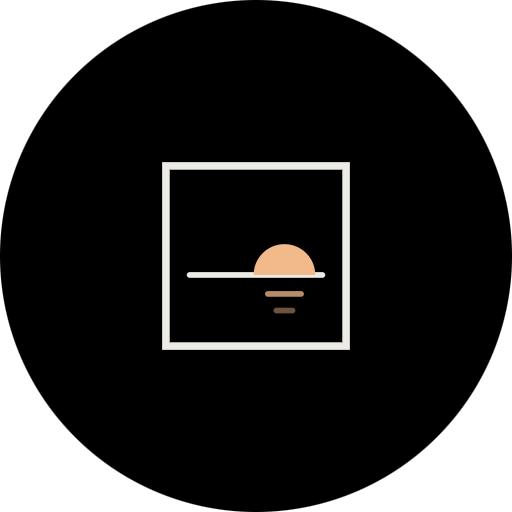
</p>

<h1 align="center">Quiet</h1>

<p align="center">
  A calm, text-only Android launcher that helps you use your phone less.<br>
  The phone stays almost colourless; colour arrives only through art and music.
</p>

<p align="center">
  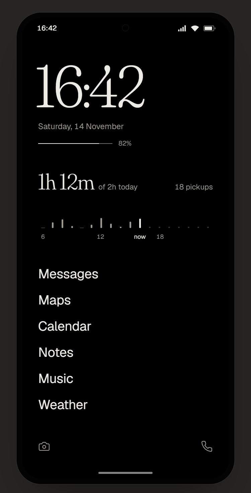
  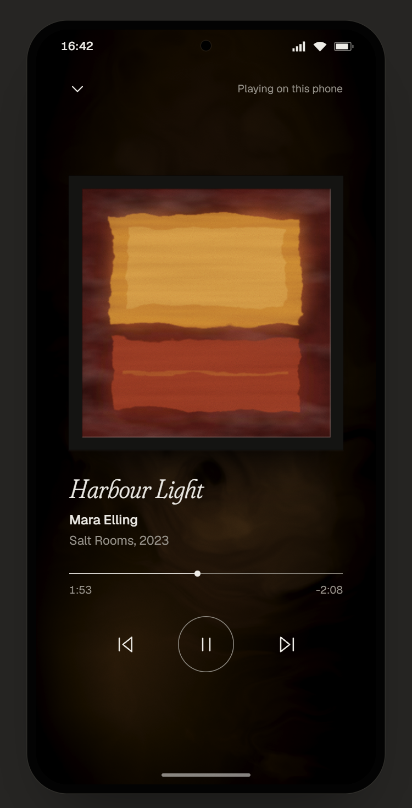
  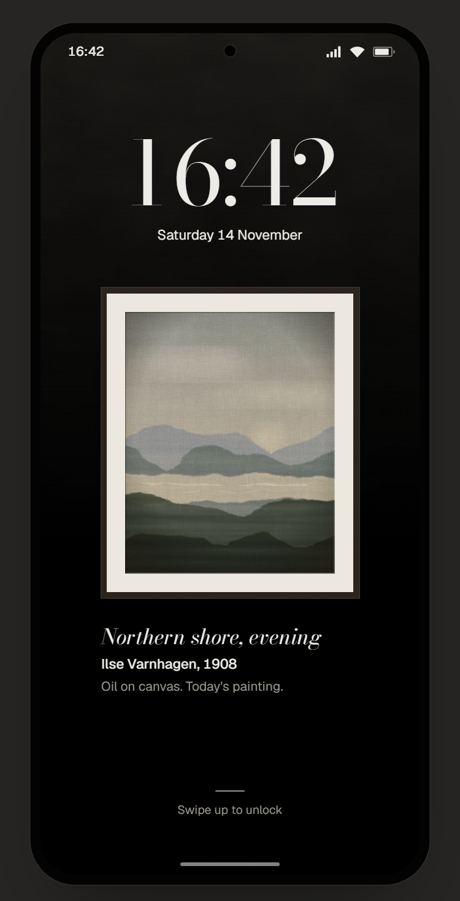
</p>

> Screenshots are rendered from the design previews with placeholder artwork. Cover art and
> paintings on a real phone come from your music app and from open museum collections.

## Why

Colourful icons, feeds and badges are built to pull you back in. Quiet removes the pull instead
of adding another app to fight it: apps are names, not icons; usage is shown honestly in words;
the lock screen is a painting, not a notification wall. There are no streaks, points or confetti.

## Features

**Home**
- Large clock (Fraunces), date, a hairline battery line with a small charging spark
- Today's screen time against your daily budget, pickups, and a day strip of minutes per hour
- Favourite apps as text; long press any app to add, rename, hide, block or uninstall
- Phone and camera on the corners; swipe left for all apps, up for Google search, down for notifications, double tap to lock

**Now playing**
- The cover appears as a small framed card; tap it and it opens into a framed artwork with a gallery label
- The cover's own colours drift behind it through an AGSL shader, capped so text always stays readable
- Long press to hide it until the next song or turn it off

**All apps**
- Search that opens the top match on Enter, letter sections, work-profile apps
- An A to Z scroller with a magnifying wave, a trailing letter bubble and haptic ticks

**Lock screen**
- Five styles: *Daily masterpiece* (public-domain paintings from the Art Institute of Chicago, The Met and the Cleveland Museum of Art), *Quiet canvas* (generative art that gets calmer the less you used your phone), *Tonight's sky* (the real moon phase and today's sun path), *Typeset* (a type poster) and *Cover of the moment*
- Three lock typefaces (Bodoni Moda, Instrument Serif, Big Shoulders); press and hold the lock screen to switch styles and fonts
- Works two ways: as the **system lock-screen wallpaper** (your phone keeps its own clock and fingerprint unlock) or as **Quiet's own lock screen** with an interactive music player

**Focus**
- In-app time reminders per app: when time is up, just remind, close the app and block it for a while, or make you wait before reopening
- A breathing pause before opening watched apps that grows with each open, an intention question, a floating time-left bar, daily limits per app
- Block any app for 1 hour to 30 days, blocking schedules by weekday (overnight spans work), focus sessions with Do Not Disturb
- Precision mode (optional accessibility service): blocks Shorts and Reels, blocks the website version of a blocked app in your browser, locks the screen on double tap
- Notification filter: only the apps you allow can interrupt; everything else is held quietly for 7 days
- Monochrome: grayscale for chosen apps, or everything during a wind-down window
- Screen time screen: today, 7 days, per-app minutes and a plain weekly sentence

<p align="center">
  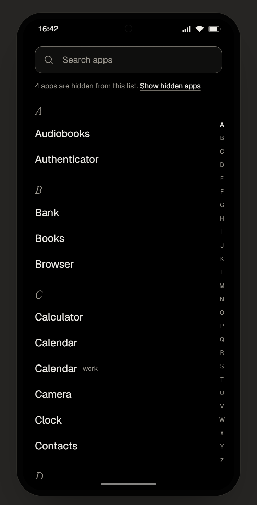
  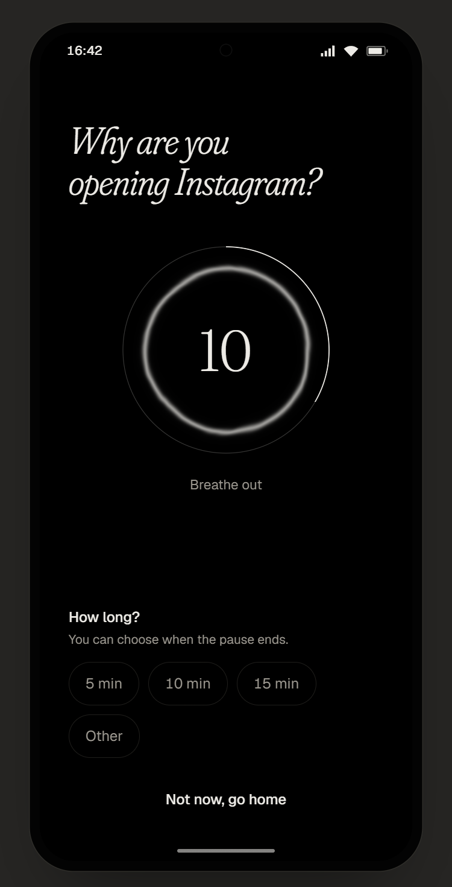
  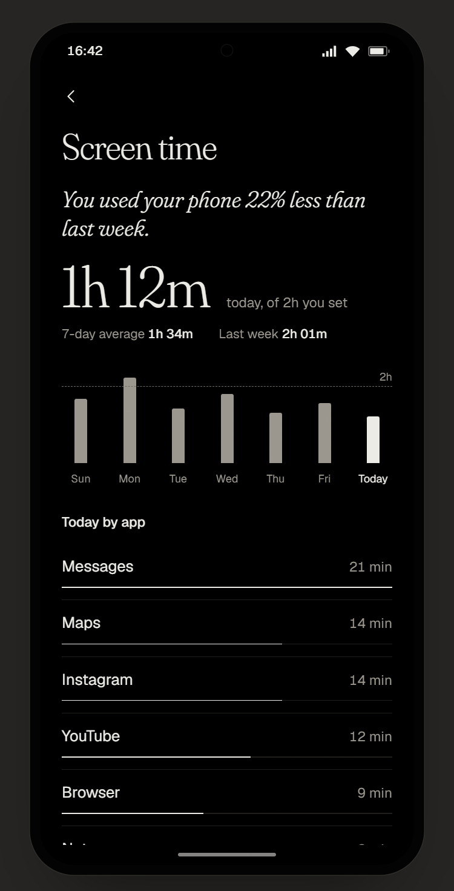
  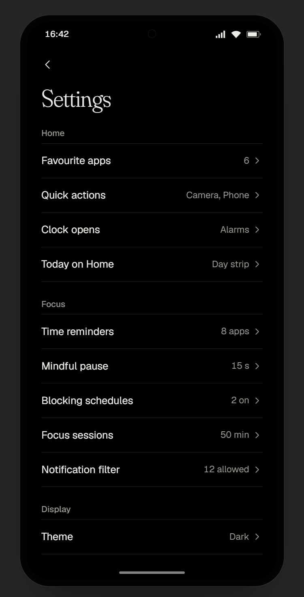
</p>
<p align="center">
  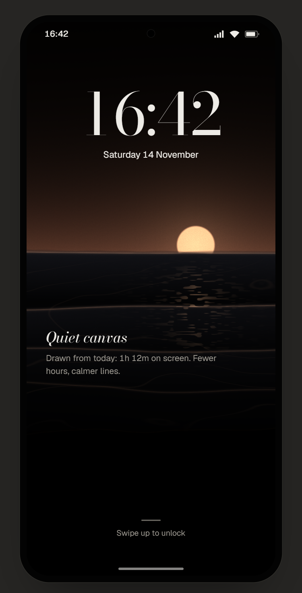
  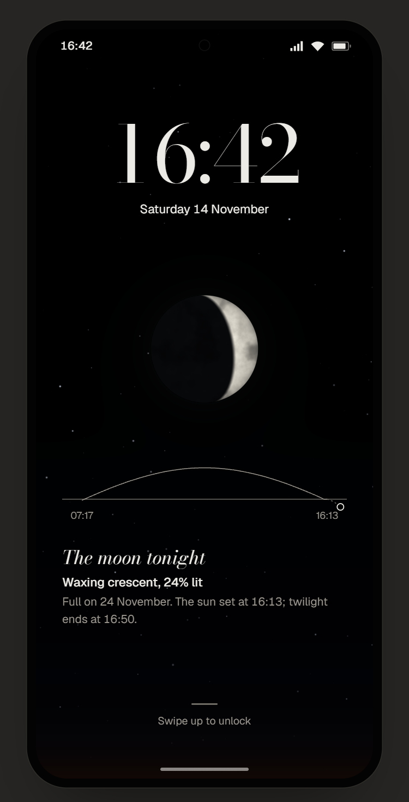
  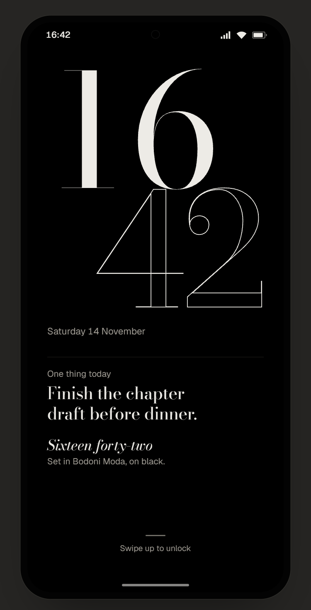
  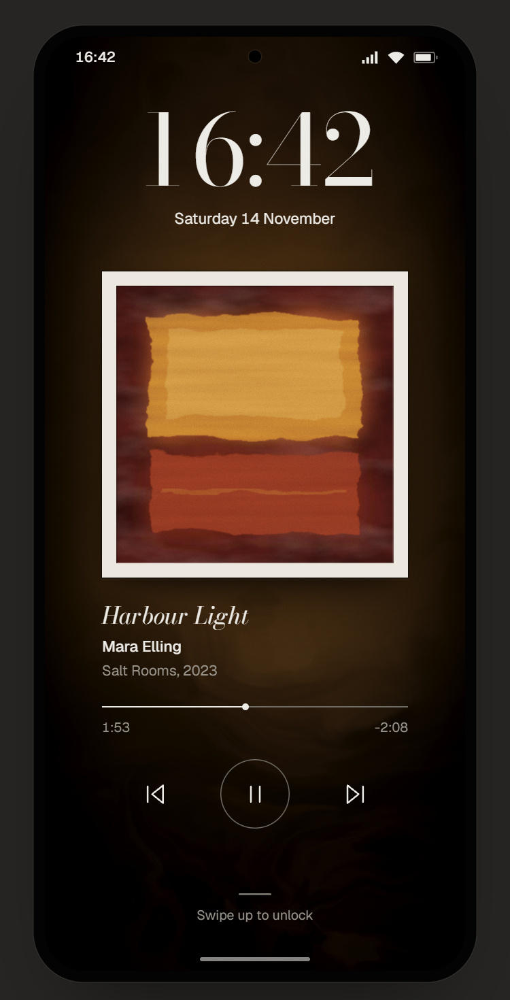
</p>
<p align="center">
  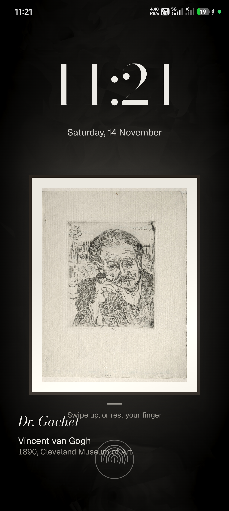<br>
  <sub>On a real phone (Xiaomi, HyperOS 3)</sub>
</p>

## Install

1. Download the APK from [Releases](../../releases), or build it yourself (below).
2. Install it, then make Quiet your home app (see [Device setup](docs/DEVICE-SETUP.md) for your phone's exact menus).
3. Open Quiet → Settings → **Permissions** and grant what you want to use.

Quiet is a personal project and is not on the Play Store. Installing over adb or from Android Studio avoids
Android 13+ "restricted settings" for accessibility and notification access.

## Permissions and why

| Permission | Used for | Needed? |
|---|---|---|
| Usage access | Screen time, day strip, reminders without precision mode | Recommended |
| Notification access | Now playing (cover art and controls), notification filter | Recommended |
| Display over other apps | Floating time bar, pauses and Quiet's lock screen | For focus features |
| Accessibility (precision mode) | Exact app detection, Shorts/Reels and website blocking, double-tap lock | Optional |
| Modify system settings | Short screen timeout while Quiet's lock screen is up | Optional |
| Do Not Disturb access | Focus sessions | Optional |
| `WRITE_SECURE_SETTINGS` (adb only) | Monochrome mode | Optional |

Grant monochrome once from a computer:

```bash
adb shell pm grant app.quiet.launcher android.permission.WRITE_SECURE_SETTINGS
```

## Privacy

No analytics, no ads, no account, no crash reporting. The only network calls fetch public-domain
paintings from museum APIs (once a day, on Wi-Fi by default). Usage data, held notifications and
everything precision mode sees stay on the phone.

## Build

Requirements: JDK 17+ and the Android SDK (compile SDK 36). From the project folder:

```bash
./gradlew :app:testDebugUnitTest :app:assembleRelease
```

The APK lands in `app/build/outputs/apk/release/`. The release build is signed with the debug key
for personal installs; set up your own signing config before distributing it.

**Stack:** Kotlin, Jetpack Compose, AGSL runtime shaders (Android 13+, with fallbacks), Room,
DataStore, WorkManager, OkHttp, kotlinx.serialization. Single module, manual dependency injection.

```
app/src/main/java/app/quiet/launcher/
  core/          models, repositories (apps, usage, settings), platform helpers, astronomy
  designsystem/  colour and type tokens, motion, gallery frame, day strip, shaders
  feature/
    home/ apps/ player/ lock/ art/ media/ usage/ settings/
    focus/ notifications/ monochrome/ hidden/
  service/       lock service, boot receiver, adb set-up commands
```

## Known limitations

- **Gestures:** some phones (notably Xiaomi HyperOS) only allow full-screen gestures with their own launcher. Use 3-button navigation there. See [Device setup](docs/DEVICE-SETUP.md).
- **Fingerprint on Quiet's lock screen:** Android stops the system fingerprint reader while another screen covers the keyguard. Quiet's lock screen hands over to the system unlock; for one-touch fingerprint unlock, use the *system lock-screen wallpaper* mode.
- **Short-video detection** relies on view IDs inside other apps and may need updating when those apps change. The rules live in `app/src/main/assets/focus_rules.json`.

## Credits

- Fonts under the SIL Open Font License: Fraunces, Geist, Bodoni Moda, Instrument Serif, Big Shoulders Display
- Paintings: public-domain works from the Art Institute of Chicago, The Metropolitan Museum of Art and the Cleveland Museum of Art open-access collections; credit is shown with each work

## License

[MIT](LICENSE)
